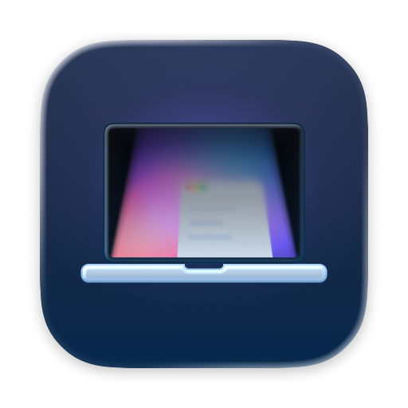
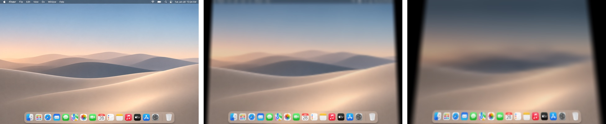

<p align="right"><a href="README.md">한국어</a></p>

<p align="center">
  
</p>

<h1 align="center">LidBlur</h1>

<p align="center">Close your MacBook, and the screen folds away into a blur.</p>

<p align="center">
  
</p>

LidBlur is a menu bar app that turns closing and opening your MacBook into a foldable-device moment.

As the lid comes down, the screen tilts like a folding panel and softly blurs and dims from its outer edge. Open it again and the picture retraces its path back to sharp. The effect follows your MacBook's lid angle sensor in real time, so if you stop the lid, the effect stops with it.

## Features

- **Follows the lid:** tilt, blur and shading move with the lid angle, live.
- **Real perspective:** the whole screen tilts like a panel into a trapezoid, and the blur deepens smoothly toward the outer edge.
- **Next to no battery use:** while the lid is open, LidBlur only checks the sensor now and then. It draws only once you start lowering the lid.
- **Screen content stays on your Mac:** frames are processed in GPU memory and discarded right away. Nothing is saved or sent, and the app has no network code.
- **Adjustable:** change the start angle, maximum tilt, and blur and shading strength.
- **Menu bar toggle** and optional launch at login.

## Install

LidBlur is distributed **only on the Mac App Store**, for free. It is being prepared for release.

This repository does not publish built apps or installers. Updates come through the App Store only.

### Requirements

- macOS 15 or later
- Works in real time on MacBooks with a lid angle sensor. On Macs without one, a timed animation plays when you open the lid.
- The effect is drawn on the built-in display only. External displays are left alone.
- The app is available in English and Korean, following your Mac's language setting.

## First launch

LidBlur needs the **Screen & System Audio Recording** permission to draw its effect. On first launch a setup window walks you through requesting it, opening System Settings and relaunching the app. To see it again later, choose **Open Permission Guide** from the menu bar icon.

LidBlur reads the screen only so it can draw the current picture tilted and blurred while the lid comes down. It starts reading only when the lid nears the start angle, and stops a few seconds after you open it again.

## Privacy

LidBlur collects no personal data. See the [privacy policy](https://nextline-ai.github.io/lidblur/privacy/).

## Development

The Xcode project is generated with [XcodeGen](https://github.com/yonaskolb/XcodeGen).

```bash
xcodegen generate
open LidBlur.xcodeproj
```

| Folder | Contents |
| --- | --- |
| `App/` | The LidBlur menu bar app |
| `Shared/` | Lid angle sensor, screen capture, Metal renderer and shaders, settings UI |
| `Lab/` | BlurLab, a development app for tuning the effect |
| `CLI/` | `lidblur-render`, which applies the effect to a single image |
| `Design/Icon/` | App icon sources |
| `docs/` | Measurement notes, privacy policy |

- Bundle ID: `work.nextline.lidblur`
- Signing is pinned to the NextLine team. To build it yourself, change the team and signing settings in `project.yml` to your own.
- The lid angle sensor is read with IOKit HID. Reading it inside the sandbox needs the `com.apple.security.device.usb` entitlement.

## License

Source code and documentation are under the [MIT License](LICENSE). The LidBlur, NextLine and DEAUM names and logos, the app icon and the design sources are not covered by the MIT License. If you distribute an app built from this code, replace the name and icon with your own. See [LICENSE](LICENSE) for the full terms.

## Contact

<picture>
  <source media="(prefers-color-scheme: dark)" srcset="Shared/Assets.xcassets/NextLineLogo.imageset/nextline-dark.png">
  
</picture>

Please report bugs and suggest features in [Issues](https://github.com/nextline-ai/lidblur/issues).

Developed by NextLine · [nextline.work](https://nextline.work) · [contact@nextline.work](mailto:contact@nextline.work)<br>
Distributed by DEAUM · [deaum.org](https://deaum.org)

<sub>LidBlur is an independent app and is not affiliated with Apple. · <a href="https://nextline-ai.github.io/lidblur/privacy/">Privacy policy</a></sub>
