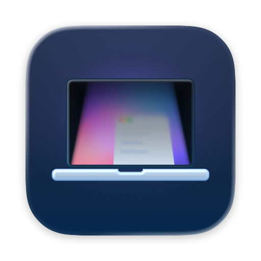
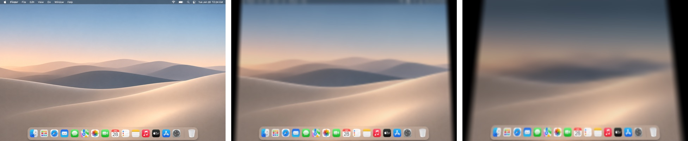

<p align="right"><a href="README.en.md">English</a></p>

<p align="center">
  
</p>

<h1 align="center">LidBlur</h1>

<p align="center">맥북 덮개를 닫으면, 화면이 접히듯 흐려집니다.</p>

<p align="center">
  
</p>

LidBlur는 맥북 덮개를 닫고 여는 순간을 폴더블 기기처럼 바꿔 주는 메뉴 막대 앱입니다.

덮개를 내리면 화면이 접히는 패널처럼 사다리꼴로 기울면서 바깥쪽 끝부터 부드럽게 흐려지고 어두워집니다. 다시 열면 같은 길을 되짚어 또렷한 화면으로 돌아옵니다. 효과는 맥북의 덮개 각도 센서를 실시간으로 따라가므로, 덮개를 멈추면 효과도 그 자리에 멈춥니다.

## 특징

- **덮개 각도를 그대로 따라감:** 기울기와 블러, 음영이 덮개 각도에 맞춰 실시간으로 움직입니다.
- **원근이 살아 있는 접힘:** 화면 전체가 패널처럼 기울어 사다리꼴이 되고, 블러는 바깥쪽으로 갈수록 단계 없이 짙어집니다.
- **배터리를 거의 쓰지 않음:** 덮개가 열려 있을 때는 센서만 가끔 확인합니다. 효과는 덮개를 내리기 시작할 때만 그립니다.
- **화면 내용은 기기 안에서만:** 화면은 GPU 메모리에서만 처리하고 바로 버립니다. 저장하거나 보내지 않으며, 네트워크 코드가 없습니다.
- **원하는 대로 조정:** 시작 각도, 최대 기울기, 블러와 음영 세기를 바꿀 수 있습니다.
- **메뉴 막대에서 켜고 끄기**, 로그인할 때 자동으로 실행하기.

## 설치

LidBlur는 **Mac App Store에서만** 배포합니다. 무료입니다. 지금은 출시를 준비하고 있습니다.

이 저장소에는 빌드한 앱이나 설치 파일을 올리지 않습니다. 업데이트도 App Store로만 받습니다.

### 요구 사항

- macOS 15 이상
- 덮개 각도 센서가 있는 맥북에서 실시간으로 동작합니다. 센서가 없는 맥에서는 덮개를 열 때 시간에 맞춘 애니메이션으로 대신합니다.
- 효과는 맥북 내장 화면에만 그립니다. 외부 모니터는 그대로입니다.
- 앱은 한국어와 영어를 지원하며, 맥의 언어 설정을 따릅니다.

## 처음 시작할 때

화면에 효과를 그리려면 **화면 및 시스템 오디오 기록** 권한이 필요합니다. 처음 실행하면 안내 창이 열려 권한 요청, 시스템 설정 열기, 앱 다시 시작을 차례로 도와 줍니다. 나중에 다시 보려면 메뉴 막대 아이콘에서 **권한 설정 안내 열기**를 누르세요.

LidBlur가 화면을 읽는 이유는 덮개가 내려가는 동안 지금 화면을 기울이고 흐리게 그리기 위해서입니다. 덮개가 효과 시작 각도 가까이 내려왔을 때만 화면을 읽고, 다시 열면 몇 초 뒤 멈춥니다.

## 개인정보

LidBlur는 어떤 개인정보도 수집하지 않습니다. 자세한 내용은 [개인정보 처리방침](https://nextline-ai.github.io/lidblur/privacy/)을 보세요.

## 개발

프로젝트는 [XcodeGen](https://github.com/yonaskolb/XcodeGen)으로 만듭니다.

```bash
xcodegen generate
open LidBlur.xcodeproj
```

| 폴더 | 내용 |
| --- | --- |
| `App/` | 메뉴 막대 앱 LidBlur |
| `Shared/` | 덮개 각도 센서, 화면 캡처, Metal 렌더러와 셰이더, 설정 화면 |
| `Lab/` | 효과를 조정해 보는 개발용 앱 BlurLab |
| `CLI/` | 이미지 한 장에 효과를 적용하는 렌더러 `lidblur-render` |
| `Design/Icon/` | 앱 아이콘 원본 |
| `docs/` | 측정 기록, 개인정보 처리방침 |

- 번들 ID: `work.nextline.lidblur`
- 서명은 NextLine 팀으로 고정되어 있습니다. 직접 빌드하려면 `project.yml`의 팀과 서명 설정을 자신의 것으로 바꾸세요.
- 덮개 각도 센서는 IOKit HID로 읽습니다. 샌드박스 안에서 읽으려면 `com.apple.security.device.usb` 권한이 필요합니다.

## 라이선스

소스 코드와 문서는 [MIT 라이선스](LICENSE)를 따릅니다. LidBlur, NextLine, DEAUM의 이름과 로고, 앱 아이콘과 디자인 원본은 MIT 라이선스에 포함되지 않습니다. 이 코드로 만든 앱을 배포하려면 이름과 아이콘을 직접 만든 것으로 바꿔야 합니다. 자세한 조건은 [LICENSE](LICENSE)에 있습니다.

## 문의

<picture>
  <source media="(prefers-color-scheme: dark)" srcset="Shared/Assets.xcassets/NextLineLogo.imageset/nextline-dark.png">
  
</picture>

버그 제보와 기능 제안은 [Issues](https://github.com/nextline-ai/lidblur/issues)에 남겨 주세요.

개발 NextLine · [nextline.work](https://nextline.work) · [contact@nextline.work](mailto:contact@nextline.work)<br>
배포 DEAUM · [deaum.org](https://deaum.org)

<sub>LidBlur는 Apple과 관계없는 독립 앱입니다. · <a href="https://nextline-ai.github.io/lidblur/privacy/">개인정보 처리방침</a></sub>
