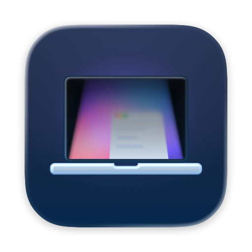
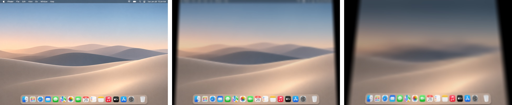

# LidBlur

맥북 덮개를 닫으면, 화면이 접히듯 흐려집니다. · Close your MacBook, and the screen folds away into a blur.

LidBlur는 Mac App Store에서만 무료로 배포합니다. · LidBlur is available only on the Mac App Store, for free.

## 지원 / Support

- **효과가 보이지 않아요 / No effect:** 시스템 설정 → 개인정보 보호 및 보안 → 화면 및 시스템 오디오 기록에서 LidBlur를 켜고 앱을 다시 실행하세요. 메뉴 막대 아이콘의 **권한 설정 안내 열기**에서 같은 과정을 안내합니다.
  Turn on LidBlur in System Settings → Privacy & Security → Screen & System Audio Recording, then relaunch the app. The menu bar item **Open Permission Guide** walks you through it.
- **덮개를 움직여도 반응이 없어요 / No response to the lid:** 덮개 각도 센서가 없는 맥에서는 덮개를 열 때 시간에 맞춘 애니메이션만 나옵니다.
  On Macs without a lid angle sensor, LidBlur plays a timed animation when you open the lid.
- **외부 모니터 / External displays:** 효과는 내장 화면에만 그립니다. · The effect is drawn on the built-in display only.
- 버그 제보와 기능 제안 / Bug reports and suggestions: [GitHub Issues](https://github.com/nextline-ai/lidblur/issues) · [contact@nextline.work](mailto:contact@nextline.work)

## 링크 / Links

- [개인정보 처리방침 / Privacy Policy](privacy/)
- [소스 코드 / Source code](https://github.com/nextline-ai/lidblur)

개발 NextLine · [nextline.work](https://nextline.work) — 배포 DEAUM · [deaum.org](https://deaum.org)
